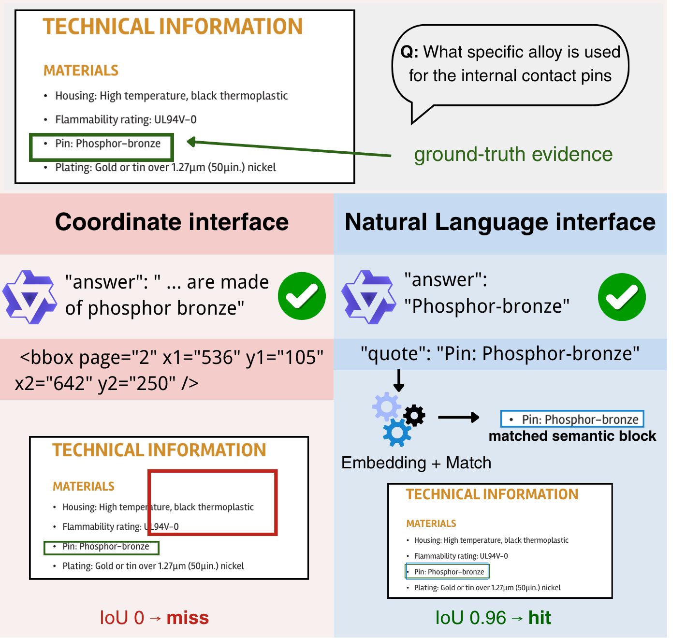

<div align="center">

# Evidence Attribution in Visual Document Understanding<br>without Coordinates or Region Labels

**Zhuchenyang Liu · Yao Zhang · Yu Xiao**<br>
Aalto University

**Accepted to EACL 2027 (Main Conference)**

[](https://arxiv.org/abs/2607.24651)
[](https://arxiv.org/abs/2607.24651)
[](https://huggingface.co/Ryenhails/quote-and-retrieve-8b-grpo)
[](https://huggingface.co/datasets/Ryenhails/quote-and-retrieve-eval)
[](https://github.com/Ryenhails/quote-and-retrieve/actions/workflows/ci.yml)
[](LICENSE)

[Paper](https://arxiv.org/abs/2607.24651) ·
[Model](https://huggingface.co/Ryenhails/quote-and-retrieve-8b-grpo) ·
[Evaluation set](https://huggingface.co/datasets/Ryenhails/quote-and-retrieve-eval) ·
[Training set](release/grpo_train_ids.jsonl) ·
[Reproduction details](docs/reproduction_details.md)



</div>

## Overview

When a vision-language model answers a question about a document, we usually ask it to point at
its evidence by generating bounding-box coordinates. Open models then very often answer correctly
while citing the wrong region. This failure is called **Attribution Hallucination**, and it has
been read as a missing grounding capability.

We keep the model, the pages, the questions, and the scoring fixed, and change only how the model
expresses evidence:

| interface | what the model outputs | who produces the box |
|---|---|---|
| **coordinate** | box coordinates, token by token | the model |
| **language** | verbatim quotes, as text | a layout parser and a retriever, outside the model |

Two findings follow.

1. **The failure is largely an artifact of the coordinate interface.** Across six open models
   from four families, evidence recall rises from at most 8.1 under coordinates to 25.9–46.9
   under the language interface, and the hallucination rate roughly halves, with little change
   in answer quality.
2. **Attribution can be trained without region labels.** A GRPO recipe whose reward reads only
   the gold answer and crops of the retrieved regions raises an 8B model's strict attributed
   accuracy from 22.4 to 33.8.

## Results

719 verified single-document questions from CiteVQA. Rec: evidence recall at IoU 0.5. SAA: strict
attributed accuracy. AH: attribution hallucination rate (lower is better).

| model | Rec (coord.) | Rec (language) | SAA (coord.) | SAA (language) | AH ↓ (coord.) | AH ↓ (language) |
|---|---:|---:|---:|---:|---:|---:|
| Qwen3-VL-8B | 0.3 | **39.9** | 1.4 | **22.4** | 97.0 | **41.2** |
| Qwen3-VL-30B-A3B | 1.3 | **34.9** | 3.8 | **24.7** | 92.1 | **47.0** |
| Qwen3.5-9B | 4.0 | **25.9** | 11.0 | **29.6** | 87.3 | **65.4** |
| Qwen3.5-27B | 8.1 | **46.9** | 16.1 | **51.5** | 82.1 | **40.5** |
| Gemma-3-12B | 0.3 | **29.9** | 1.0 | **10.7** | 95.9 | **48.0** |
| Gemma-4-31B | 7.8 | **44.5** | 9.2 | **42.4** | 87.1 | **38.6** |
| Qwen3-VL-8B + GRPO (ours) | – | **51.3** | – | **33.8** | – | **28.4** |

## Quick start

No documents, no models, no GPU:

```bash
git clone https://github.com/Ryenhails/quote-and-retrieve.git
cd quote-and-retrieve
python src/score_citevqa.py examples/sample_predictions.jsonl
python src/score_citevqa.py examples/sample_predictions_coordinate.jsonl
```

```
examples/sample_predictions.jsonl              recall 62.5   precision 83.3   page_recall 75.0
examples/sample_predictions_coordinate.jsonl   recall 25.0   precision 33.3   page_recall 62.5
```

Four synthetic questions with the same correct answers in both files; only the evidence interface
differs. One coordinate prediction lands on the right page but misses the element, and one
produces no parseable box at all.

## Install

```bash
pip install -r requirements.txt
pip install pytest && pytest tests/ -q     # 11 tests, no downloads, under a second
```

Scoring, the control experiments, and the tests need only `numpy` and `scipy`. Inference,
retrieval, and training additionally need `torch`, `transformers`, and the parsing and serving
stack listed in `requirements.txt`.

The Python scripts locate everything through three environment variables with working defaults
(`PROJECT_ROOT`, `QR_CACHE`, `QWEN3VL_EMB_REPO`). The batch scripts in `slurm/` additionally use
conda-environment and partition placeholders; set them for your cluster before submitting.
[`docs/reproduction_details.md`](docs/reproduction_details.md) lists the variables together with
the model revisions, the per-backbone output budgets, the parser version and command, and the
training hyperparameters.

## Released artifacts

| artifact | what it is |
|---|---|
| [🤗 quote-and-retrieve-8b-grpo](https://huggingface.co/Ryenhails/quote-and-retrieve-8b-grpo) | Qwen3-VL-8B trained with the region-label-free GRPO recipe |
| [🤗 quote-and-retrieve-eval](https://huggingface.co/datasets/Ryenhails/quote-and-retrieve-eval) | the 719-question verified evaluation set: identifiers, verification metadata, and normalised ground-truth boxes |
| [`release/grpo_train_ids.jsonl`](release/grpo_train_ids.jsonl) | the training set: identifiers and page windows of the 1,584 training and 83 validation questions from LongDocURL |

The model only writes text, this repository turns its quotes into page regions, and the
evaluation set says which regions were correct.
[`docs/using_the_release.md`](docs/using_the_release.md) shows how the pieces fit, with the
commands to reproduce the trained model's row of the main table, to run the model on your own
documents, and to rebuild the training set.

## Method

**Language interface.** The model reads all pages and returns an answer together with verbatim
quotes of its evidence. A layout parser segments every page into typed semantic blocks. One
multimodal encoder embeds both the quotes and the rendered block crops, and a one-to-one
assignment maps each quote to a block, whose page and box become the citation. Block crops are
embedded as images, because about thirty percent of the evidence is non-textual and rendered
tables match plain-language quotes poorly in text space. Candidates come from the whole document
and the model's own page guess is ignored, so a page error stays recoverable.

**Region-label-free training.** For each question the policy samples several responses. Each is
parsed into an answer and quotes, resolved to block crops by the same retrieval step, and scored
by a vision-language judge on answer correctness, evidence relevance, and evidence coverage. The
reward multiplies the answer term by the evidence terms, so evidence only counts when the answer
is already correct. The judge reads the retrieved crops, so a fluent quote assigned to the wrong
block scores low. Nothing in this signal is a region label: the gold answer ships with the
dataset, the retriever is unsupervised, and the judge sees only crops.

## Reproducing the paper

Steps 1 and 2 need the public document corpora cited in the paper; steps 3 onward need GPUs.

```bash
# 1. Build the verified evaluation set (987 -> 719 questions)
python src/build_citevqa_pub.py
python src/build_citevqa_eval.py

# 2. Parse documents (MinerU 3.2.3) and cache block embeddings, once per document
sbatch slurm/mineru_parse.sh
python src/prebuild_block_emb.py

# 3. Run the interface comparison, one job per backbone (both interfaces)
sbatch --export=ALL,BACKBONE=qwen3vl slurm/matrix_backbone.sh    # see docs/reproduction_details.md
python  src/match_wholedoc.py                                     # language interface only
python  src/score_citevqa.py outputs/matrix/<condition>/predictions.jsonl

# 4. Judge-based metrics (SAA, AH) and the main table
python src/build_judge_batch.py && sbatch slurm/judge_batch.sh
python src/score_judge_batch.py
python src/build_main_table.py --results outputs/judge/batch_results_all.jsonl \
    --preds qwen3vl_nl=outputs/matrix/qwen3vl_nl_wd/predictions.jsonl    # one tag=path per condition

# 5. Control experiments; these reuse the frozen outputs of step 3
python src/controls_rereview.py snap        # coordinate boxes snapped to blocks
python src/controls_rereview.py funnel      # filtering funnel, dropped-document analysis
python src/controls_rereview.py stats       # paired bootstrap and McNemar
python src/controls_rereview.py precision   # citation precision, citations per response
python src/controls_rereview.py breakdown   # per-language and per-evidence-type
sbatch slurm/controls_embed.sh              # retrieval-only baselines, abstention curve
python src/resolver_ablation.py             # lexical and BM25 resolvers, quote fidelity
sbatch slurm/docling_parse.sh && sbatch slurm/docling_match.sh    # independent parser

# 6. Region-label-free training
python src/rehydrate_grpo_train.py --longdocurl /path/to/LongDocURL_public.jsonl \
    --pdf-root /path/to/pdf_files                  # 1,584 train + 83 validation questions
python src/build_grpo_longdoc.py
sbatch slurm/mineru_parse_longdoc.sh               # candidate blocks for the reward service
sbatch slurm/grpo_longdoc_chain.sh                 # judge server, reward service, and trainer

# 7. Tables and the figure added in the camera-ready version
sbatch slurm/revision_gpu_dump.sh
for t in filter qtype budget buckets anls; do python src/revision_analysis.py $t; done
python src/make_fig_sidebyside.py
```

Compute reported in the paper: about **85 GPU-hours** for training, about **60 single-GPU-hours**
for the thirteen-condition evaluation matrix, and under two GPU-hours for the diagnostics.

## Scoring

All conditions share one scorer. A citation matches an annotated element when both lie on the
same page and their IoU is at least 0.5. Recall is computed per question over the **necessary**
elements and macro-averaged over questions. Precision replicates the released scorer's loop,
annotated elements hit divided by boxes cited, and is matched against **all** annotated evidence
so that citing optional supporting material is not an error.

Recall is monotonic in the number of citations: citing every parsed block would reach the parser
ceiling at a precision below one percent. Every table therefore reports both.

Details, including the two protocol choices that are ours and not the benchmark's, are in
[`docs/scoring_protocol.md`](docs/scoring_protocol.md); the record format is in
[`docs/data_format.md`](docs/data_format.md). Both are asserted by the test suite.

## Repository layout

<details>
<summary>Scripts, one line each</summary>

```
src/
  infer_matrix.py             run one backbone under one interface over the evaluation set
  match_wholedoc.py           quote -> semantic block retrieval and one-to-one assignment
  mineru_extract_cache.py     turn the layout parser's output into per-page candidate blocks
  prebuild_block_emb.py       cache one crop embedding per parsed block, per document
  mineru_ceiling.py           parser ceiling: recall attainable with a perfect retriever
  score_citevqa.py            the single scoring path: recall, precision, F1, page recall
  build_citevqa_pub.py        build the verified evaluation set (the filtering funnel)
  build_citevqa_eval.py       assemble per-question ground-truth tuples
  build_judge_batch.py        format judge requests (answer quality, evidence relevance)
  submit_judge_batch.py       submit the judge batch
  score_judge_batch.py        parse judge scores into SAA and AH
  build_main_table.py         reproduce the main results table
  controls_rereview.py        snapping, funnel, significance, precision, breakdowns
  resolver_ablation.py        lexical, BM25, text-embedding, crop-embedding resolvers
  retrieval_baselines.py      retrieval-only baselines and the abstention similarity export
  cross_parser_docling.py     re-parse the corpus with an independent layout parser
  cross_parser_match.py       re-run matching against the independent parser's blocks
  table_multithreshold.py     multi-threshold recall tables
  rehydrate_grpo_train.py     join the released training identifiers with LongDocURL
  build_grpo_longdoc.py       training-set construction from the long-document corpus
  check_leakage_robust.py     document-overlap check between training and evaluation PDFs
  rollout_longdoc.py          rollout: parse, retrieve, crop, judge
  reward_longdoc_grpo.py      the gated reward
  reward_service.py           reward server used during training
  accumulate_metrics.py       keep training metrics across the self-resubmitting job chain
  revision_analysis.py        camera-ready tables: question types, filtering, matched budget, ANLS
  revision_gpu_dump.py        retrieval boxes and per-element residual labels those tables need
  revision_cases.py           text listing of cases where the two retrieval readings differ
  make_figures.py             all figures in the paper
  make_fig_sidebyside.py      the side-by-side evidence figure
  qr_paths.py                 path defaults (PROJECT_ROOT, QR_CACHE, QWEN3VL_EMB_REPO)
configs/    rollout prompt template and the language-interface system prompt
slurm/      one batch script per stage
release/    identifiers of the 1,667 training questions
examples/   four synthetic questions under both interfaces
tests/      scoring-protocol tests, runnable without any data
docs/       scoring protocol, record format, reproduction details, and how to use the release
```

</details>

Not included: model weights, the source PDF corpora, and cached embeddings. These come from the
public releases cited in the paper and are regenerated by the scripts above. The evaluation and
training sets are distributed as question identifiers, not as redistributed document content.

## Citation

The paper will appear in the proceedings of EACL 2027. Until the proceedings entry is available,
please cite the arXiv version:

```bibtex
@article{liu2026evidence,
  title         = {Evidence Attribution in Visual Document Understanding without Coordinates or Region Labels},
  author        = {Liu, Zhuchenyang and Zhang, Yao and Xiao, Yu},
  journal       = {arXiv preprint arXiv:2607.24651},
  year          = {2026},
  eprint        = {2607.24651},
  archivePrefix = {arXiv},
  primaryClass  = {cs.CV},
  url           = {https://arxiv.org/abs/2607.24651},
  note          = {Accepted to EACL 2027}
}
```

## License

MIT, see [LICENSE](LICENSE). The benchmarks, parsers, and models this code builds on are covered
by their own licenses.
